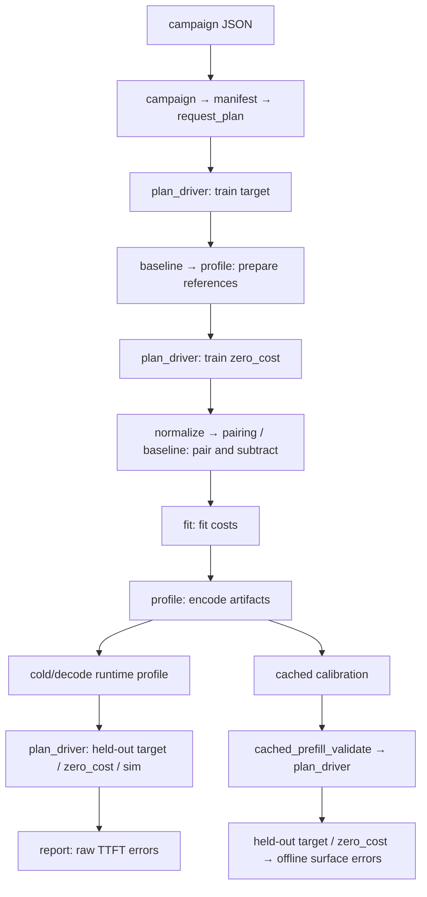

# sim-calibrate: Implementation and Campaign Examples

> **TL;DR:** Define a fixed matrix in JSON and fit costs using the original vllm-bench, a shared evidence proxy, and reference subtraction. Cold/decode campaigns produce a loadable sim profile and a held-out TTFT report; cached-prefill campaigns produce a separate calibration artifact and an offline error report.
>
> **Last touched:** 2026-11

## 1. Implementation and Call Chain

`scripts/sim-calibrate/` takes a campaign JSON containing the client configuration, the target/zero_cost/sim roles, named matrices, and an artifact directory outside the repository. The compiler expands the matrices and saves batches, logical request keys, seeds, and cached-prefix text. The executor collects training target measurements, prepares references, collects zero_cost measurements, then pairs requests, subtracts references, and fits costs.



Every collection uses `plan_driver → vllm_bench → original vllm-bench → evidence_proxy → server`. Responses are parsed by `sse_evidence` and converted into measurements by `vllm_bench.convert_evidence`. For decode, `steady_state` computes the common window; `artifacts` then seals the attempt. The bench summary JSON is diagnostic; reported metrics come from proxy events.

`campaign.py execute` orchestrates the full cold/decode pipeline: the caller normally starts the target beforehand, while the orchestrator starts and stops reference and fitted sim services using their profiles. `run` collects specified roles/cells; externally started reference and sim services require a local PID. For cached campaigns, use `execute --through-fit` to finish training, then `cached_prefill_validate.py collect` for the dedicated held-out collection. `validate` consumes existing measurements, and `verify` explicitly recomputes the report.

Endpoints must support `/v1/completions`, SSE, and output token IDs. Cold/decode requests use token-ID prompts; cached campaigns also require actual prompt IDs and per-request cached-token usage in responses. Whenever the target cache is on, every cell, including decode, must declare a cache lifecycle. Cold/decode cells use HTTP reset; cached cells can use HTTP reset or a managed restart. This prevents an interrupted attempt from warming prompts reused by a retry. An OpenAI-compatible service that only streams text cannot directly provide the evidence this pipeline requires.

There is currently no cached Rust predictor, separate mixed fit, frozen error tolerance, or publication stage. Inputs of 32k tokens and concurrency 256 are configurable when server capacity permits; the recorded campaign does not cover these limits.

## 2. Measurement Rules and Batches

A repeat is a fixed batch: it sends exactly C requests with maximum concurrency C and does not replace completed requests. The next batch starts only after all requests and proxy writes have finished. Warmup and measured batches use the same collection rules; warmup samples are excluded from fitting and error distributions. Cached campaigns also bootstrap a prefix of P tokens with no uncached tail.

| Item | Definition |
| --- | --- |
| Request start | Monotonic timestamp when the proxy dispatches the upstream request. |
| TTFT | Time from request start to the first SSE event with nonempty **output token IDs**. Prompt IDs, role, usage, and finish-only events do not count. |
| First-text latency | Time from request start to the first nonempty output-text event. Recorded separately; it does not replace token-ID TTFT. |
| E2E | Time from request start to upstream EOF, including final usage and the stream tail. |
| SSE timestamp | Timestamp of the upstream read that completes the event boundary. Multiple events in one read may share a timestamp; token times are not interpolated. |
| Decode coordinates | B is the batch's request count; `num_ctx` is the initial **total** context. Each request has `num_ctx / B` input tokens, which must divide evenly. |
| Request pairing | Pair by the logical cell/phase/repeat/index key, then compare actual prompts, tokens, and bodies with the model-routing field removed. Identical content under different keys is allowed. |

Decode fitting uses the generation-event window shared by every request in a batch: `start = max(first output time per request)`, `end = min(last output time per request)`. Only complete intervals between adjacent events whose endpoints both lie within this inclusive window are retained. The denominator is the output-token count of the right-hand event; events containing multiple tokens are not split. Each request's window TPOT is the sum of retained durations divided by the sum of token counts. Requests are then averaged equally within each batch, followed by an equal-weight average across measured repeats.

Training batches require a positive window, at least one complete interval per request, and positive total duration and token denominator per request. There are no additional interval-count, jitter, or percentile-trimming thresholds. Held-out decode windows are diagnostic and do not prevent complete TTFT pairs from entering the report. Proxy-observed TPOT is an effective black-box cost, not a GPU scheduler step trace.

Requests with no output IDs are classified as unsupported. One accepted limitation remains: if only some generation events carry IDs and usage or other evidence does not reveal the omission, the remaining IDs may be mistaken for the complete generated sequence.

## 3. Reference Preparation and Subtraction

References are generated after all training target measurements are collected. Cold/cached references have zero prefill and decode costs. A training decode reference uses its target cell's qualified window mean, rounded to an integer-microsecond interval δ. Its profile has zero prefill cost and a constant decode cost δ; mixed cost is their sum.

| Training type | Subtraction formula | Cell representative |
| --- | --- | --- |
| Cold prefill | `effective = target_TTFT - reference_TTFT` | Median of measured paired differences. |
| Steady decode | `frontend_residual = reference_window_TPOT - δ`; `effective = target_window_TPOT - frontend_residual` | Equal-weight means across requests → batches → repeats. |
| Cached prefill | `effective = target_TTFT - reference_TTFT`, with reference δ required to be zero | Median of measured paired differences. |

For decode, subtracting the known δ from the reference measurement prevents simulated decode work from being mistaken for frontend overhead. Negative residuals and negative per-request effective costs are retained without clipping. Final cold/cached cell representatives must be nonnegative; decode representatives must be positive. Non-training cells use zero-cost references and do not contribute to training reference preparation or fitting.

Within each cache-recovery group, the cached target first bootstraps a prefix of P tokens, then runs P+N requests. Actual prompt IDs must match the plan, and `observed_cached_tokens` must equal exactly P for warmup/measured requests. The zero_cost service does not need a prefix cache. The fitted cost includes processing the N uncached tokens against the existing P cached KV tokens.

## 4. Fitting Rules

Fitting reads only complete, qualified normalized data with `scope=train`. All C>1 TTFT measurements are excluded from fitting; window TPOT from C>1 decode batches can still be used for training. Held-out data does not influence parameters, reference intervals, or candidate selection.

| Candidate | Inputs and purpose |
| --- | --- |
| `cold_prefill_piecewise_linear` | Input tokens and effective TTFT at C=1, with at least two distinct input lengths. Retains sampled knots and uses piecewise-linear interpolation within the domain. |
| `decode_2d_surface` | A complete B × initial total context grid of effective TPOT values, with bilinear interpolation within the domain. The sole decode fit and runtime model. |
| `cached_prefill_surface` | A complete P×N grid with at least two points per axis, using medians of paired differences and bilinear interpolation within the domain. |

Missing required cells/repeats cause the corresponding fit to fail; remaining samples are not used to fill missing grid points. Out-of-domain evaluation rejects extrapolation. Variance/MAD are retained as diagnostics.

## 5. Profiles, Artifacts, and Readers

Cold/decode uses piecewise prefill and the decode surface, converts millisecond costs to integer microseconds, and generates Rust profile schema 3, manifest schema 2, and selection schema 3. Runtime mixed cost is `prefill + decode` with a zero intercept. Export requires both normalized and fit inputs to carry the current campaign ID.

Serving a functional profile requires prefill, decode, and mixed components because request arrivals can produce all three step types. A partial functional model can still be loaded and estimated directly, but `with_engine_profile` rejects it for serving. Old profile schemas receive a migration error before their contents are decoded into the current structure.

Positive workloads must be covered by the actual curves to be evaluated; declaring an outer coverage range does not fill gaps in the curves. A coverage minimum of zero allows a step to have no work of that type; it does not create measured knots at zero or enable extrapolation. If a planned step is outside the domain or otherwise cannot be priced by the predictor's declared model, the sim rolls back that step and fails its requests while continuing to serve subsequent requests. Internal scheduler or engine errors remain fatal.

Cached fitting generates a separate schema-3 calibration artifact containing the P/N axes, cost surface, and direct input paths, with `runtime_enabled=false`. The runtime profile does not enable a cached predictor even when the same campaign also fits cold/decode costs.

Main artifacts are stored under `artifact_root` outside the repository:

```text
compiled_campaign.json, artifact_index.json, plans/<cell_id>/request_plan.json
workloads/<cell_id>/*.jsonl                     # compiled cached inputs
execution_index.json, raw/<role>/<cell_id>/attempt-N/
references/preparation.json, references/<preparation_id>/<cell_id>/
derived/train.normalized.json, derived/fit.json
profiles/sim/{profile.json,calibration.manifest.json,selection.json}
derived/cached_prefill/calibration.json
reports/{validation.json,cached_validation.json}
diagnostics/environment.json
```

The manifest records the target/model, runtime configuration, client, workload, and source locations. Digests are used only for actual request-content pairing, actual profile/manifest file binding, ID/deterministic-input generation, and the model declaration, tokenizer config, and numerical-source fields required by Rust. The raw index lists paths; it has no whole-bundle or per-file raw SHA. Source code and dependency versions are not execution gates. Environment versions are recorded together in diagnostics.

Normal stages read their direct artifacts without recursively opening training files. When reading a sealed decode attempt, the reader recomputes its window statistics from the plan and measurement envelope with `verify_statistics` and compares the values with `decode_statistics.json`. Resuming sealed work reuses the selected attempt. Failed or interrupted attempts are retained, and explicitly resuming collection creates a new attempt. Report verification and normalized-source recomputation read the fixed selected attempts and reconstruct requests, SSE events, measurements, and values from raw evidence. Other attempts added later are excluded from that recomputation. The Python contracts are incompatible with older artifact formats.

## 6. Held-out Reporting Rules

The standard report covers all declared non-training cold/decode cells, requires complete target/zero_cost/sim pairing, and must include a C>1 queueing cell. It first computes `absolute = abs(sim_TTFT - target_TTFT)` and `relative = absolute / target_TTFT` per request, then reports p50/p95/p99 for actual and predicted TTFT and absolute/relative errors per cell. Split and overall summaries are also saved. The reference baseline is not subtracted again during reporting.

The dedicated cached report covers all declared non-training cached cells and requires only target/zero_cost. Its primary comparison is the surface prediction against each cell's median paired effective cost; per-request error distributions are saved separately. When effective cost is zero or negative, relative error is null, while absolute error and undefined counts are retained. `prediction + reference_TTFT for the same key` is an offline diagnostic that reconstructs target TTFT.

For the standard report, succeeded means the required roles, scope, counts, coverage, and statistics are complete. Missing evidence produces results such as partial/replay_required. Neither report type imposes a business accuracy threshold: `accuracy_acceptance=not_assessed`. A complete report can still contain large errors.

The [two-model RTX 3090 campaign](../../benchmarks/sim-calibrate-serving-3090-20261103.md) records 38 cells generated by the current implementation, including the 1-token cold point and the minimum shared decode context of 4. Its two standard and two cached held-out reports succeeded and were recomputed from raw evidence after stopping the targets. The snapshot and companion JSON retain the measured errors; accuracy remains `not_assessed`.

Report results apply to the exact campaign matrix and profile used to produce them. Comparing accuracy across campaigns requires matching their workloads; an overall error from one matrix does not establish an improvement over a different matrix.

## 7. Script Responsibilities

All files below are under `scripts/sim-calibrate/`.

| File | Entry point | Responsibility |
| --- | --- | --- |
| [campaign.py](../../../scripts/sim-calibrate/campaign.py) | CLI | Stage orchestration for compile, prepare-reference, run, and execute; environment recording. |
| [manifest.py](../../../scripts/sim-calibrate/manifest.py) | Internal | Configuration validation, matrix expansion, cell/campaign identities, and runtime configuration. |
| [request_plan.py](../../../scripts/sim-calibrate/request_plan.py) | Internal | Batches, phases, logical keys, stable seeds, and cached bootstrap plans. |
| [measurement_schema.py](../../../scripts/sim-calibrate/measurement_schema.py) | Internal | Shared measurement fields, timing/retry protocols, reference policies, and content digests. |
| [artifacts.py](../../../scripts/sim-calibrate/artifacts.py) | Internal | Compilation/execution indexes, locks, attempt storage, sealing, resumption, and artifact writes. |
| [plan_driver.py](../../../scripts/sim-calibrate/plan_driver.py) | Internal | The sole collection driver: service/process binding, cache recovery, per-batch bench execution, draining, conversion, and sealing. |
| [probe.py](../../../scripts/sim-calibrate/probe.py) | Internal | Readiness probes that do not generate tokens, listener/process binding, and reset/restart receipt rules. |
| [vllm_bench.py](../../../scripts/sim-calibrate/vllm_bench.py) | Internal | Bench/launcher paths and versions, commands and subprocesses, and conversion from proxy raw evidence to measurements. |
| [evidence_proxy.py](../../../scripts/sim-calibrate/evidence_proxy.py) | Internal | HTTP/SSE forwarding observations, request-ID attribution, at-most-once upstream forwarding, and raw writes. |
| [sse_evidence.py](../../../scripts/sim-calibrate/sse_evidence.py) | Internal | Incremental framing and parsing of output IDs/text/usage/finish/DONE. |
| [steady_state.py](../../../scripts/sim-calibrate/steady_state.py) | Internal | Common decode windows, qualification, and request/batch/repeat aggregation. |
| [pairing.py](../../../scripts/sim-calibrate/pairing.py) | Internal | Scope and role/key/content pairing, selected-attempt reads, and explicit recomputation from raw evidence. |
| [baseline.py](../../../scripts/sim-calibrate/baseline.py) | CLI/Internal | Target-only decode statistics, reference preparation, actual interval reads, and training subtraction. |
| [normalize.py](../../../scripts/sim-calibrate/normalize.py) | CLI | Paired observations, training subtraction/qualification, and selected attempts. |
| [fit.py](../../../scripts/sim-calibrate/fit.py) | CLI | Numerical prefill/decode/cached fitting and evaluation within the domain. |
| [profile.py](../../../scripts/sim-calibrate/profile.py) | CLI | Encoding, units, and coverage for runtime bundles and separate cached calibration artifacts. |
| [cached_prefill.py](../../../scripts/sim-calibrate/cached_prefill.py) | Internal | Nested text/ID/JSONL generation and validation of actual prompts, usage, exact P, and request attribution. |
| [cached_prefill_validate.py](../../../scripts/sim-calibrate/cached_prefill_validate.py) | CLI | Cached collect/validate/verify, surface errors, and TTFT reconstruction. |
| [report.py](../../../scripts/sim-calibrate/report.py) | CLI | Standard held-out raw TTFT, error percentiles, required-scope completeness, and explicit recomputation. |

[`requirements-evidence-proxy.txt`](../../../scripts/sim-calibrate/requirements-evidence-proxy.txt) lists the Python dependencies for the evidence proxy and cached workload generation, including `tokenizers`. Collection requires Linux and `/usr/bin/setpriv`, provided by the `util-linux` system package.

## 8. Campaign Examples

### 8.1 Cold/Decode: Complete Spec

This is a structurally complete configuration template. Replace the angle-bracket placeholders for bench/tokenizer paths, versions, and the target model-config digest, and match runtime settings, model names, and server_flags to the actual services. Runtime fields not overridden by `zero_cost` and `sim` inherit from target; these two roles must have identical scheduler/cache configurations. The target model digest is retained solely for Rust manifest export.

```json
{
  "kind": "campaign_spec",
  "schema_version": 10,
  "client": {
    "name": "vllm-bench", "version": "<bench-version>",
    "binary": "<absolute-path-to-vllm-bench>", "tokenizer": "<local-model-directory>",
    "seed": 7,
    "sampling": {"temperature": 0, "top_p": 1, "ignore_eos": true},
    "generation": {
      "dataset": "random", "shuffle": false,
      "prompt_representation": "token_ids", "seed_policy": "stable_coordinates_v1"
    },
    "timing": {
      "clock": "monotonic", "first_token": "first_output_token_ids_event",
      "last_token": "last_output_token_ids_event", "first_text": "first_nonempty_output_text_event",
      "text_fallback": "disabled", "return_token_ids": true, "echo": false,
      "decode_interval_tokens": "right_event_output_token_count",
      "measurement_origin": "http_sse_proxy", "request_start": "proxy_upstream_dispatch",
      "event_observation": "proxy_upstream_read"
    },
    "retry": {
      "max_upstream_attempts_per_key": 1,
      "duplicate_policy": "fail_batch", "client_retry_control": "unavailable"
    }
  },
  "variants": {
    "target": {
      "identity": {
        "endpoint": "http://127.0.0.1:19090", "model": "Qwen3-4B",
        "engine": "vllm", "engine_version": "<target-version>", "model_revision": "local",
        "model_config_sha256": "<actual-SHA-256-of-config.json>"
      },
      "runtime": {
        "backend": "vllm", "parallelism": "1", "quantization": "none",
        "scheduler": {
          "policy": "vllm_v1", "max_num_seqs": 4,
          "max_num_batched_tokens": 8192, "max_model_len": 8192,
          "prefill": {"mode": "whole"}
        },
        "cache": {"policy": "off"}
      },
      "server_flags": []
    },
    "zero_cost": {
      "identity": {
        "endpoint": "http://127.0.0.1:19190", "model": "Qwen3-4B",
        "engine": "pegainfer-sim", "engine_version": "local", "model_revision": "local"
      },
      "runtime": {"backend": "pegainfer-sim", "cache": {"policy": "off"}},
      "server_flags": []
    },
    "sim": {
      "identity": {
        "endpoint": "http://127.0.0.1:19290", "model": "Qwen3-4B",
        "engine": "pegainfer-sim", "engine_version": "local", "model_revision": "local"
      },
      "runtime": {"backend": "pegainfer-sim", "cache": {"policy": "off"}},
      "server_flags": []
    }
  },
  "workload": {
    "matrices": {
      "prefill-train": {
        "kind": "cold_prefill", "split": "train", "input_tokens": [1, 64, 2048],
        "concurrency": 1, "output_tokens": 1, "warmup_repeats": 1, "repeats": 3,
        "arrival": {"mode": "fixed_batch"}
      },
      "decode-train": {
        "kind": "steady_decode", "split": "train", "concurrency": [1, 4],
        "num_ctx": [4, 256, 2048], "output_tokens": 16, "warmup_repeats": 1, "repeats": 3,
        "arrival": {"mode": "fixed_batch"}
      },
      "prefill-heldout": {
        "kind": "cold_prefill", "split": "sealed_test", "input_tokens": [1024],
        "concurrency": 1, "output_tokens": 1, "warmup_repeats": 1, "repeats": 3,
        "arrival": {"mode": "fixed_batch"}
      },
      "decode-heldout": {
        "kind": "steady_decode", "split": "sealed_test", "concurrency": [1, 2],
        "num_ctx": [1024], "output_tokens": 16, "warmup_repeats": 1, "repeats": 3,
        "arrival": {"mode": "fixed_batch"}
      }
    }
  },
  "output": {"artifact_root": "/tmp/sim-cali-example/cold-decode"}
}
```

This configuration expands to nine training cells and three held-out cells. For decode, B=2 with num_ctx=1024 means two requests with 512 input tokens each. The minimum training total context is 4, which is divisible by both training batch sizes, 1 and 4. B=1 with total context 1–3 remains outside the decode surface. A one-token prompt generating only one output token uses the measured prefill knot and needs no decode step; generating further tokens can fail when the first decode step is below the measured domain. Axes also accept `{"values":[...]}` or `{"start":...,"stop":...,"step":...}` with an inclusive stop. Decode output length currently accepts only 8 or 16. The actual bench executable's version is read during compilation.

Save the spec with placeholders replaced to `/tmp/sim-cali-example/campaign.json`, then check compilation from the repository root:

```bash
.venv/bin/python -B scripts/sim-calibrate/campaign.py compile --spec /tmp/sim-cali-example/campaign.json --dry-run
```

This step does not start model services. For an actual run, first use compile to write artifacts, then execute to orchestrate training, profile generation, and standard held-out validation. You can also use prepare-reference, run, and the individual stage CLIs separately. Complete reference and sim profiles are generated at their respective stages; a zero_cost profile is not required beforehand.

### 8.2 Cached: Replace the Workload and Target Cache

Reuse the client, variants, and timing contract above, but replace target.runtime.cache with the object below; keep zero_cost/sim caches off. The actual target service must enable a matching prefix cache. The reset path requires a working HTTP reset endpoint:

```json
{"policy": "on", "block_alignment": 16, "endpoint_isolated": true}
```

Replace the entire workload with the following, and set artifact_root to `/tmp/sim-cali-example/cached`:

```json
{
  "matrices": {
    "cached-train": {
      "kind": "cached_prefill", "split": "train",
      "prefix_tokens": [256, 512], "new_tokens": [64, 128],
      "concurrency": 1, "output_tokens": 1, "warmup_repeats": 1, "repeats": 3,
      "arrival": {"mode": "fixed_batch"},
      "generation": {"dataset": "custom", "prompt_representation": "text"},
      "shared_prefix": {"identity": "example-prefix", "suffix_mode": "request_index"},
      "cache_lifecycle": {
        "namespace": "cached-train", "reset_before": "repeat",
        "bootstrap_repeats": 1, "recovery": "reset"
      },
      "bootstrap_output_tokens": 1
    },
    "cached-heldout": {
      "kind": "cached_prefill", "split": "sealed_test",
      "prefix_tokens": [384], "new_tokens": [96],
      "concurrency": 1, "output_tokens": 1, "warmup_repeats": 1, "repeats": 3,
      "arrival": {"mode": "fixed_batch"},
      "generation": {"dataset": "custom", "prompt_representation": "text"},
      "shared_prefix": {"identity": "example-prefix", "suffix_mode": "request_index"},
      "cache_lifecycle": {
        "namespace": "cached-heldout", "reset_before": "repeat",
        "bootstrap_repeats": 1, "recovery": "reset"
      },
      "bootstrap_output_tokens": 1
    }
  }
}
```

Save the resulting spec to `/tmp/sim-cali-example/cached-campaign.json`, then check compilation:

```bash
.venv/bin/python -B scripts/sim-calibrate/campaign.py compile --spec /tmp/sim-cali-example/cached-campaign.json --dry-run
```

This configuration has four training points and one held-out point inside the domain. Sharing the same shared_prefix.identity keeps prefixes nested across P values. P must meet the actual engine's cache alignment. For models such as Qwen3.5, adjust it to the actual state-retention boundary rather than copying 16. Targets without reset can choose recovery=restart and supply argv, environment, and startup_timeout in target.launch; the driver then manages a restart for each group.

Cached training produces a calibration artifact when run through-fit. The dedicated collect/validate/verify commands then generate or recompute its report. To fit only a cached surface, declare only cached training matrices. If cached held-out matrices are declared, use through-fit to explicitly end the training stage before starting dedicated validation.
